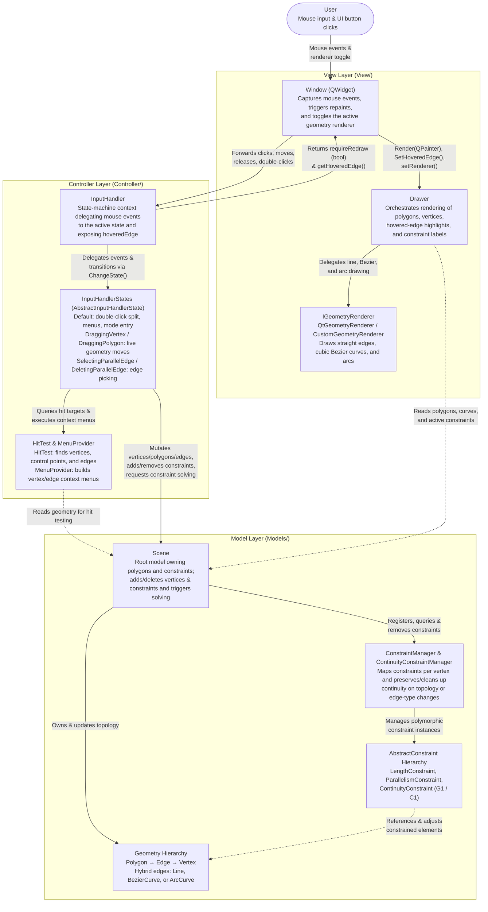

# 2D Geometry Engine Documentation (C++/Qt)


https://github.com/user-attachments/assets/b74130e8-7949-4e51-ba0d-78f2d2b5a913


## 0. Introduction and Design Goals
The application is an advanced 2D CAD-style vector graphics engine operating on an architecture of vertices (`Vertex`), edges (`Edge`), and polygons (`Polygon`). The main objective of the project is to provide a stable, real-time responsive interface with support for dynamic constraints (`Constraints`) – both geometric (length, parallelism) and mathematical curve continuity ($G0, G1, C1$).

### Core Design Principles:
* **Relaxation-Based Constraint Solving:** Changing the state of any vertex propagates cascadingly across the dependency graph based on a BFS algorithm.
* **Hybrid Edge Model:** A segment connecting two vertices can be interpreted as a straight line, a cubic Bézier curve, or a circular arc. Regardless of curvature, geometric constraints (e.g., length, parallelism) operate on the virtual base straight line connecting the main vertices.
* **Stability Over Perfection:** The constraint-solving algorithm enforces a fixed maximum iteration budget. If the user applies conflicting relations, the system rejects the transaction and restores the last stable scene state rather than freezing the interface or corrupting the topology.

> **A quick note:** I built this over 3+ weeks as a self-imposed C++ refresher. I wrote the core logic, model, controller and relaxation solver algorithm almost entirely by hand—I wanted to use this project as an intense C++ course with a deadline and had so much fun while learning and programming with this language. Great experience.

---

## 1. Technologies Used and Running the Project
### Technologies:
* **Programming Language:** C++ (C++17 standard or newer)
* **Framework:** Qt (modules: Qt Core, Qt GUI, Qt Widgets – window management, mouse event handling, and the `QPainter` rendering engine)
* **Build System:** CMake

---

### Method 0: Pre-built Release (Windows / Wine)
Download the last release directory, unzip and run the CAD_2D_Engine.exe (`wine .../CAD_2D_Engine.exe` on Linux)

---

### Method 1: Building the project from the Command Line (CMake CLI)
If you have the Qt package and a C++ compiler with CMake installed without Qt Creator:
1. Open a terminal in the project root directory.
2. Configure the project by passing the path to the Qt library directory using the `-DCMAKE_PREFIX_PATH` flag:
   ```bash
   cmake -B build -S . -DCMAKE_PREFIX_PATH="C:/Qt/6.x.x/mingw_64"
   ```
3. Build the project:
   ```bash
   cmake --build build
   ```

---

### Method 2: Running the project via Qt Creator
1. Install the Qt package along with the **Qt Creator** IDE (via the official *Qt Online Installer*).
2. Launch Qt Creator.
3. Select **File -> Open Project** and point to the **`CMakeLists.txt`** file located in the project root directory.
4. In the project configuration window, select an available toolchain (*Kit*, e.g., *Desktop Qt 6.x / MSVC, MinGW, or GCC*) and click **Configure Project**.

---


## 2. User Guide (Controls and Mouse Interaction)

The application relies entirely on cursor interaction.

### Left Mouse Button (LMB) Actions:
* **Click and drag a main vertex:** Modifies the polygon geometry. Connected constraints are recalculated cascadingly.
* **Click and drag a control point (red square):** Modifies the tangent vectors of a Bézier curve. When $G1$/$C1$ continuity is active, it also enforces matching adjustments on the adjacent curve.
* **Click inside a figure and drag:** Translates (moves) the entire polygon along with all its curves without violating internal constraints.
* **Double-click on an edge:** Splits the selected edge in half and inserts a new vertex at the clicked location.

### Right Mouse Button (RMB – Context Menu) Actions:
* **Click on a Vertex:**
  * Opens the option to delete the vertex (available if the polygon has $>3$ vertices).
  * Opens the **Continuity** ($G0, G1, C1$) submenu allowing mathematical smoothness to be enforced between the edges meeting at that vertex (available only if at least one of those edges is a circular arc or a Bézier curve).
* **Click on an Edge:**
  * **Length Constraint:** Adds or removes a fixed dimension (prompts for the target length in a dialog window).
  * **Parallelism Constraint:** Enforces parallelism relative to another edge (enters selection mode where the second edge is picked with an LMB click).
  * **Edge Type:** Converts the edge between a straight segment ("Line"), a Bézier Curve, and a Circular Arc.

---

## 3. Architecture and Data Model

The application follows a structured Model–View–Controller (MVC) architecture with strong emphasis on pointer lifecycle management (smart pointers).

### 3.1. MVC Architecture Overview



* **View (`Window`, `Drawer`, `IGeometryRenderer`):** Responsible strictly for user presentation and input capture. `Window` forwards mouse events to `InputHandler`, repaints the widget whenever the controller reports a change, and allows switching between `QtGeometryRenderer` and `CustomGeometryRenderer` at runtime. `Drawer` reads the current state directly from `Scene` (along with the hovered edge from `InputHandler`) and delegates rasterization to the active renderer.
* **Controller (`InputHandler`, `AbstractInputHandlerState` subclasses, `HitTest`, `MenuProvider`):** Implemented using the State pattern. `InputHandler` delegates incoming events to the active state (`Default`, `DraggingVertex`, `DraggingPolygon`, `SelectingParallelEdge`, or `DeletingParallelEdge`), which uses `HitTest` and `MenuProvider` to interpret user intent, mutate the `Scene`, trigger constraint solving, and transition between states.
* **Model (`Scene`, `Polygon`, `Edge`, `Vertex`, `ConstraintManager`, `AbstractConstraint`):** Encapsulates all geometric topology, hybrid curve representations, and constraint rules. `Scene` acts as the central facade coordinating geometry mutations, constraint registration/cleanup, and constraint solving without any dependency on the View or Controller.

### 3.2. Geometry Hierarchy
* **`Vertex`:** Basic position container (`QPointF point`). Has no knowledge of edges. Shared between adjacent edges via `std::shared_ptr`.
* **`Edge`:** Object connecting two `Vertex` nodes. Represents the base line segment. Composes curve geometry via `std::unique_ptr<BezierCurve>` and `std::unique_ptr<ArcCurve>`.
  * `BezierCurve` stores two additional unique `Vertex` objects serving as local control points.
  * `ArcCurve` does not own separate vertices – it defines geometry through a signed scalar `radius` (with the sign determining convexity) and an `isMajorArc` flag.
* **`Polygon`:** A sequential collection of edges stored in `std::vector<std::unique_ptr<Edge>>`. Handles translation, point-in-bounding-box detection (`isClicked`), and vertex/edge insertion and removal.
* **`Scene`:** Root container storing polygons and managing the constraint system (`ConstraintManager`).

### 3.3. Constraint Management (`ConstraintManager`)
The application maintains a global dependency graph in the following structure:
`std::unordered_map<const Vertex*, std::vector<std::shared_ptr<AbstractConstraint>>> Constraints`

Each constraint (`LengthConstraint`, `ParallelismConstraint`, `ContinuityConstraint`) inherits from `AbstractConstraint`. Polymorphism requires concrete constraint classes to implement `Fix(immovableVertex)`, `getError()`, and the list of vertices affected by the constraint (`affectedVertices()`).

---

## 4. Implemented Constraints Satisfaction Algorithm

### Relaxation Solver (`TrySolveConstraints` and `SolveConstraints`)

An algorithm for resolving overlapping geometric relationships, based on **BFS (Breadth-First Search)** propagation.
1. The starting point of the queue is the modified `Vertex` (or control point).
2. The algorithm pops a vertex from the queue, retrieves its constraints, and for every constraint whose error `getError()` exceeds its tolerance threshold `maxError()`, executes the corrective `Fix()` method.
3. All vertices reported as `affectedVertices()` by the repaired constraint are then pushed to the back of the queue (if not already present in the queue during the current step).
4. **Infinite Loop Protection:** After the new constraint is added to the scene the `TrySolveConstraints` is called. At the beginning the method creates a snapshot of the scene. The method maintains a per-constraint iteration counter. Reaching the limit without zeroing out errors (`success = false`) aborts the queue, removes the most recently added constraint, and restores a complete snapshot of vertex coordinates and curve/radius parameters (`previous_state` rollback). After the adding of the new constraint succeeded, when `SolveConstraints` is invoked during vertex dragging, the scene is already known to be in a solvable state, so no snapshot is created.
